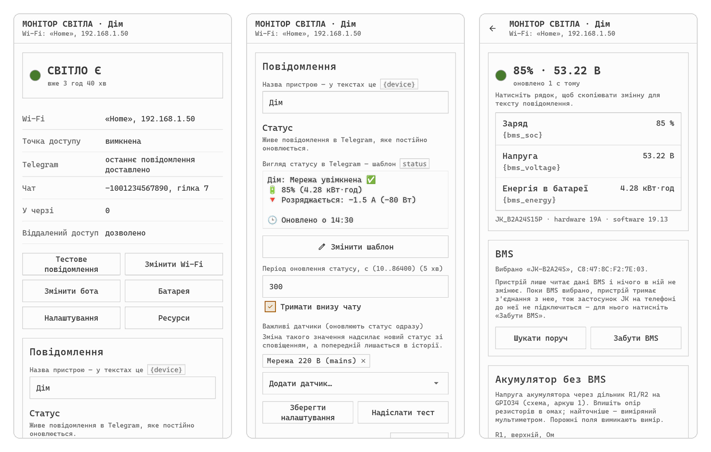
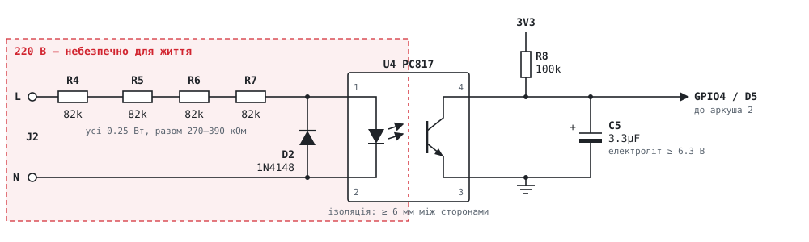

# Монітор світла

Невеликий пристрій, який стежить, чи є вдома 220 В, і повідомляє, коли світло зникає або з'являється.
Живиться від того самого акумулятора, що тримає роутер під час відключень, тож повідомлення
«світло зникло» встигає піти. Може також міряти напругу акумулятора або читати JK BMS.

> Дім: Мережа вимкнена ❌
> 🔋½ 51% (8.83 кВт·год)
> 🔻 Розряджається: -2.1 А (-110 Вт)
>
> 🕒 Оновлено о 21:40

<picture>
  <source media="(prefers-color-scheme: dark)" srcset="docs/screens-dark.png">
  
</picture>

<details>
<summary><b>In English</b></summary>

A small ESP32 device that watches whether the house has 220 V mains and posts to Telegram when power goes
out or comes back. It runs from the same battery that keeps the router up during outages, so the "power is
out" message gets through. It can also measure the battery voltage through a divider or read a JK BMS over
Bluetooth. Setup is a web page on the device itself: no cloud, no Home Assistant. The firmware is Rust on
ESP-IDF; ready images for an ESP32 with 4 MB flash are in the
[releases](https://github.com/pavver/power-monitor/releases). There is also an ESPHome variant for a
Wemos D1 mini and Home Assistant. The docs are in Ukrainian; issues in English are welcome.

</details>

## Можливості

- **Повідомлення в Telegram:** у чат, групу або гілку форуму. Живий статус, що оновлюється в реальному часі, та гнучкі автоматизації на основі шаблонів зі змінними й умовами.
- **Без хмари й без Home Assistant:** налаштування через сторінку пристрою. Перший запуск відкриває
  точку доступу з покроковим майстром: Wi-Fi, потім бот.
- **Напруга акумулятора** через дільник на АЦП (свинцевий, LiFePO4 — будь-який до 80 В) або **JK BMS** по
  Bluetooth: заряд, напруга, запас енергії в кВт·год.
- **Нічого не губиться:** якщо разом зі світлом пропав інтернет, події стоять у черзі й ідуть, щойно
  зв'язок повернеться, з позначкою, коли це сталося.
- **Оновлення по Wi-Fi** з відкатом: якщо нова прошивка не стартує, повертається попередня.
- **Пароль на панель**, скидання налаштувань п'ятьма короткими вмиканнями живлення.
- **Ресурси:** навантаження процесора, оперативна пам'ять, NVS, флеш і стек кожної задачі просто на
  панелі.
- **Віддалена підтримка** (необов'язково): можна відкрити панель пристрою, що стоїть в іншому місці,
  через власний сервер.

Є і варіант для **Home Assistant** на Wemos D1 mini з ESPHome: він лише передає «світло є/немає» і
напругу акумулятора, а повідомлення надсилає Home Assistant.

## З чого почати

1. **Зберіть пристрій** за [інструкцією](hardware/README.md). Там три варіанти: модуль ESP32-WROOM-32 на
   власній платі, готова плата ESP32 DevKit або Wemos D1 mini для Home Assistant.
2. **Прошийте:** ESP32 — готовим образом із [релізів](#готова-прошивка) або
   [зібравши самостійно](#збірка-і-прошивка), D1 mini — за [інструкцією ESPHome](esphome/README.md).
3. **Налаштуйте** через телефон: [Налаштування](#налаштування).

Серце пристрою — оптопара, що бачить 220 В і віддає ESP32 лише «є/немає»
(аркуш 3, решта схеми — в [інструкції](hardware/README.md)):

<picture>
  <source media="(prefers-color-scheme: dark)" srcset="hardware/sheet-3-mains-dark.svg">
  
</picture>

## Структура

| Тека | Що там |
| --- | --- |
| [`hardware/`](hardware) | Схеми (SVG), інструкція зі збирання, перелік деталей. |
| [`firmware/`](firmware) | Прошивка ESP32 на Rust (ESP-IDF, std): GPIO, АЦП, Wi-Fi, NVS, HTTP-сервер, Telegram, Bluetooth. `ui/index.html` — сторінка пристрою. |
| [`power-core/`](power-core) | Уся логіка без заліза: детектор, шаблони, налаштування, розбір кадрів BMS, API. Тести запускаються на ПК: `cargo test`. |
| [`esphome/`](esphome) | Конфігурація для Wemos D1 mini і Home Assistant. |
| [`server/`](server) | Сервер віддаленої підтримки (необов'язковий). |

## Готова прошивка

Кожен [реліз](https://github.com/pavver/power-monitor/releases) містить два образи для ESP32 з 4 МБ флешу,
зібрані GitHub Actions з тегу. Віддалена підтримка в них вимкнена, дільник напруги — з аркуша 1 схеми
(усе змінюється на панелі).

| Файл | Коли |
| --- | --- |
| `power-monitor-full.bin` | Перша прошивка нової плати: завантажувач, таблиця розділів і прошивка одним файлом. Пишеться з адреси `0x0` і стирає збережені налаштування. |
| `power-monitor.bin` | Оновлення пристрою, що вже працює: панель → «Налаштування» → «Прошивка» ([OTA](#оновлення-через-wi-fi-ota)). |

Записати повний образ можна будь-яким інструментом:

- **У браузері** (Chrome або Edge): [ESP Tool](https://espressif.github.io/esptool-js/) → «Connect» →
  адреса `0x0`, файл `power-monitor-full.bin` → «Program».
- **esptool:** `esptool.py --chip esp32 write_flash 0x0 power-monitor-full.bin`
- **espflash:** `espflash write-bin 0x0 power-monitor-full.bin`

Далі — [налаштування](#налаштування) з телефона.

## Збірка і прошивка

Потрібні Linux або macOS (на Windows — WSL), [Rust](https://rustup.rs) і тулчейн для ESP32:

```sh
cargo install espup ldproxy espflash --locked
espup install          # створить ~/export-esp.sh
```

Підключіть ESP32 через USB і запустіть:

```sh
./flash.sh                  # тести → збірка → прошивка → монітор порту
./flash.sh -p /dev/ttyUSB0  # явно вказати порт
./flash.sh --reset          # ще й стерти збережені налаштування
./flash.sh --no-monitor
./flash.sh --image          # лише зібрати образи: power-monitor.bin (OTA) і power-monitor-full.bin
```

Перша збірка завантажує ESP-IDF і триває 10–20 хвилин; наступні — до хвилини.

### Оновлення через Wi-Fi (OTA)

Перший раз прошивайте через USB (`./flash.sh`): так записуються таблиця розділів і завантажувач із
підтримкою відкату. Далі:

1. `./flash.sh --image` — у корені проєкту з'явиться `power-monitor.bin`.
2. Відкрийте панель пристрою → «Налаштування» → «Прошивка» → оберіть файл → «Оновити».
3. Пристрій перевіряє файл (чи це прошивка ESP32 і чи вміщується в слот), пише його у вільний слот
   (`ota_0`/`ota_1`), перевіряє контрольну суму й перезапускається.

Нова прошивка підтверджує себе, щойно запуститься вебсервер. Якщо вона впаде раніше, після
перезапуску завантажувач поверне попередню.

### Таблиця розділів (4 МБ)

| Розділ | Розмір | Призначення |
| --- | --- | --- |
| `nvs` | 208 КБ | налаштування: Wi-Fi, бот, тексти |
| `otadata`, `phy_init` | 8 + 4 КБ | службові |
| `ota_0`, `ota_1` | по 1920 КБ | два слоти прошивки для OTA |

Таблицю (`firmware/partitions.csv`) записує `espflash` під час прошивки. `flash.sh` стирає `otadata`,
щоб завантажувач запустив щойно записаний `ota_0`.

### Для розробки

- Тести логіки: `cd power-core && cargo test`.
- `./check-paths.sh` (його запускає й `flash.sh`, тож і CI) не пропускає прив'язки до однієї машини:
  абсолютних шляхів до домашніх і тимчасових тек у файлах репозиторію та `path`-залежностей Cargo поза
  репозиторієм. Дизайн-систему й інші сторонні крейти беремо з git, а не з сусідньої теки.
- Схеми перемальовує `python3 hardware/build.py`.
- Вигляд сторінки — дизайн-система [Operator UI](https://github.com/pavver/operator-design-system).
  Leptos/WASM на пристрій не влазить (≈390 КБ проти ≈320 КБ вільного місця в слоті прошивки), тому
  `ui-bundle/` на комп'ютері рендерить потрібні компоненти Leptos у звичайний HTML: таблицю стилів
  саме цих компонентів, їхню розмітку як `<template>`, іконки й таймінги анімацій. Усе це він вписує в
  `firmware/ui/index.html` між маркерами `operator-ui:begin/end`, а скрипт сторінки дає розмітці поведінку
  (як `core` дизайн-системи). Набір компонентів — список `COMPONENTS` у `ui-bundle/src/main.rs` і
  features в `ui-bundle/Cargo.toml` (ревізія дизайн-системи там же); компонент, якого сторінка не
  використовує, зупиняє збірку. Перейти на інший коміт дизайн-системи: `ui-bundle/update.sh <коміт>` (міняє ревізію, перебудовує цю частину сторінки, шрифт і, якщо задано `PLAYWRIGHT_CORE`, проганяє перевірку сторінки); після зміни списку компонентів: `cargo run --manifest-path ui-bundle/Cargo.toml`. Поведінку компонентів скрипт сторінки повторює вручну, тож якщо в новому коміті змінилися API чи поведінка компонента, перевірка це покаже;
  `flash.sh` і CI перевіряють, що бандл свіжий. Частина сторінки ще на старих ручних стилях і переходить
  на компоненти поступово.
- Шрифт сторінки — Cascadia Code, урізаний до латиниці, кирилиці, цифр і розділових знаків
  (≈26 КБ у прошивці). За ліцензією OFL змінену версію перейменовано на «Operator Mono». Після зміни
  тексту сторінки: `python3 firmware/ui/make-font.py` (скрипт зупиниться, якщо на сторінці є символ
  поза шрифтом).
- Сторінку налаштування можна перевірити в headless Chromium (Playwright) на макеті пристрою:
  `PLAYWRIGHT_CORE=/шлях/до/playwright-core node firmware/ui/ui-check.js firmware/ui/index.html /tmp/shots`.
- Скріншоти для README знімаються з того самого макета:
  `PLAYWRIGHT_CORE=… node firmware/ui/readme-shots.js /tmp/readme`, потім
  `python3 firmware/ui/readme-shots.py /tmp/readme` (перезаписує `docs/screens-*.png`).

## Налаштування

1. Увімкніть пристрій. Поки він не підключений до роутера (Wi-Fi ще не збережено або мережі немає поруч),
   він створює точку доступу «PowerMonitor-Setup». Щойно пристрій підключився до роутера і з точки доступу
   вийшли всі телефони, вона вимикається; коли зв'язок із роутером зникає, вмикається знову. Підключіться до неї телефоном — сторінка відкриється сама (або відкрийте
   http://192.168.71.1/).
2. **Wi-Fi.** Список мереж оновлюється сам. Оберіть мережу, введіть пароль. Кнопка «Підключити» чекає,
   поки пристрій справді підключиться або повідомить причину невдачі. Мережа зберігається лише після
   вдалого підключення.
3. **Повернення в домашню мережу.** Сторінка показує адресу, яку роутер видав пристрою (її можна
   скопіювати). Кнопка «Перейти в домашню мережу» вимикає точку доступу, і телефон сам повертається до
   домашнього Wi-Fi (точка доступу вимкнеться й сама, коли телефон від неї відключиться). Далі сторінку
   відкривають за цією адресою; її також видно в списку клієнтів роутера.
4. **Telegram-бот** — уже з домашньої мережі, бо телефону потрібен інтернет. Створіть бота в
   [@BotFather](https://t.me/BotFather), вставте токен (пристрій перевіряє його), напишіть боту і виберіть
   чат зі списку. Пристрій перевірить, що бот може писати в цей чат (без повідомлення), і першим
   надішле статус. У групі бот бачить лише команди, тому там треба
   надіслати `/start`. У групі з гілками кожна гілка, з якої написали, — окремий рядок списку.
5. **Панель.** Стан світла, Wi-Fi, Telegram, черга; тестове повідомлення; зміна Wi-Fi чи бота; статус,
   шаблони та автоматизації. Кнопка «Налаштування» відкриває віддалену підтримку, пароль, час і часовий
   пояс, оновлення прошивки й скидання; «Ресурси» — монітор процесора, пам'яті й задач.

### Шаблони та автоматизації

Повідомлення формуються з шаблонів. Монітор підтримує:

- **Живий статус:** одне повідомлення з шаблону `status`, яке пристрій оновлює раз на кілька хвилин (стандартно 5). Коли змінюється важливий датчик (стандартно лише мережа 220 В, список задається на панелі), приходить нове повідомлення (зі сповіщенням), а попереднє лишається в історії. Якщо статус підперли інші повідомлення, він переїжджає вниз (можна вимкнути). Шаблон `status` редагується разом з іншими, але видалити його не можна.
- **Автоматизації:** «Коли → Якщо → Дія»: подія (запуск, зміна значення, крок, поріг, час доби, кожні N секунд), умови на кшталт `mains=off`, дія — окреме повідомлення або негайне оновлення статусу.
- **Вкладені шаблони:** виклик іншого шаблону за назвою через `{@назва}` (наприклад `{@svitlo}`, `{@battery}`).
- **Умови:** `{змінна?текст}` виводить текст лише за наявності значення; `{!змінна?текст}` — коли значення відсутнє. Підтримуються перевірки рівності та нерівності: `{mains=on?Мережа є}`, `{bms_soc<20?🪫}`, `{bms_current>0?Заряджається}`.

Доступні змінні:

| Змінна | Значення |
| --- | --- |
| `{device}` | назва пристрою |
| `{mains}` | стан мережі (`on` або `off`) |
| `{ip}` | IP-адреса в домашній мережі |
| `{battery_voltage}` | напруга акумулятора через дільник, В |
| `{bms_soc}` | заряд за BMS, % |
| `{bms_voltage}` | напруга за BMS, В |
| `{bms_energy}` | залишок енергії за BMS, кВт·год |
| `{bms_current}` | струм батареї за BMS, А |
| `{bms_power}` | потужність за BMS, Вт |
| `{time}` | поточний час |
| `{date}` | поточна дата |

### Акумулятор: дільник напруги або BMS

На панелі кнопка «Батарея» відкриває екран із двома картками:

- **Акумулятор без BMS.** Впишіть опір R1 і R2 з аркуша 1 схеми в омах (найточніше — виміряні
  мультиметром). Пристрій покаже напругу; порівняйте її з мультиметром. Порожні поля вимикають вимір.
  Якщо дільник не розпаяно, вхід «висить» і показує шум замість напруги: пристрій це помічає, на екрані
  буде «шум», а в повідомленнях напруга вважатиметься невідомою.
  Поки на панелі нічого не задано, пристрій вважає, що стоять R1 330k і R2 10k з аркуша 1. Інші
  резистори можна вшити при збірці. На панелі їх можна змінити або вимкнути, а скидання до заводських
  повертає вшиті:

  ```sh
  DIVIDER_TOP_OHM=240000 DIVIDER_BOTTOM_OHM=10000 ./flash.sh
  ```
- **BMS.** «Шукати поруч» → «Обрати». Пристрій лише читає JK BMS по Bluetooth LE (протокол JK02: 24S до
  заліза 10.x, 32S з 11.x) і нічого в ній не змінює. З'єднання тримається весь час, поки BMS вибрано
  (застосунок JK на телефоні тим часом не підключиться: BMS приймає одне з'єднання). Повідомлення не
  чекає на BMS: бере останнє значення, якщо воно не старше хвилини, інакше 🤷‍♂️. Без збереженої BMS
  пам'ять Bluetooth віддається решті прошивки.

Розбір кадрів BMS перевірено на записах справжніх BMS із тестів
[esphome-jk-bms](https://github.com/syssi/esphome-jk-bms) (Apache-2.0).

### Пароль панелі

Спочатку панель відкрита. На екрані «Налаштування», у картці «Доступ до панелі», можна задати пароль (4–64 символи). Після цього
кожен браузер має увійти; зберігається лише хеш пароля з сіллю. Зміна або вимкнення пароля завершує всі
інші сесії.

### Нова IP-адреса

Пристрій пам'ятає свою останню адресу в домашній мережі. Якщо після підключення адреса інша, в Telegram
приходить посилання на панель: «🌐 Дім: нова адреса панелі http://192.168.1.50/». Це стандартна автоматизація «зміна ip», її текст
змінюється на панелі.

### Скидання до заводських налаштувань

Стирає Wi-Fi, бота, тексти, пароль і запам'ятовану адресу:

- **без доступу до панелі** (забули пароль): 5 разів поспіль увімкніть живлення і через 2–3 секунди
  вимкніть — кожне вмикання коротше за 10 секунд;
- на панелі — «Налаштування» → «Скинути все»;
- через USB — `./flash.sh --reset`.

Якщо збережена мережа недоступна під час старту, точка налаштування теж вмикається, а пристрій далі
пробує підключитися.

## Віддалена підтримка (необов'язково)

Якщо ви ставите пристрої друзям чи батькам, можна відкривати їхню панель через власний сервер
([`server/`](server/README.md)). Пристрій сам звертається до сервера, тож у мережі клієнта нічого
відкривати не треба:

- **чек-ін** раз на годину: `POST /device/checkin`; якщо на сервері для пристрою ввімкнено «Чекаю
  пристрій», чек-іни йдуть кожні 2 хв. Перший чек-ін іде за 5 с після підключення до Wi-Fi і вмикає
  «Чекаю пристрій» сам (так само після ввімкнення підтримки на панелі), тож одразу після старту сесію
  можна відкрити за кілька хвилин. Вимикається прапорець в адмінці;
- **сесія** відкривається, коли власник натиснув «Відкрити панель» на сервері (на найближчому чек-іні)
  або коли клієнт натиснув «З'єднатись зараз» у своїй панелі. Пристрій тримає одне TLS-з'єднання й
  чекає запитів (`GET /device/next`, long-poll 25 с), виконує їх своїм вебсервером і повертає відповідь.
  Працює все, що й удома, разом з OTA. Пароль панелі клієнта діє і тут;
- сесія закривається через 15 хв без запитів, кнопкою «Завершити сесію» з будь-якого боку або
  вимкненням перемикача.

За замовчуванням підтримка вимкнена: пристрій нікуди не звертається, поки в картці «Віддалена
підтримка» (екран «Налаштування») не вписати адресу сервера (лише `https://`) і не ввімкнути перемикач. Щоб нові пристрої
одразу знали ваш сервер, вшийте його при збірці:

```sh
REMOTE_SERVER=https://svitlo.example.com ./flash.sh
```

Такі пристрої стартують з увімкненою підтримкою, і клієнт може її вимкнути. Як підняти сервер —
у [server/README.md](server/README.md).

## Глосарій

- **Вікно** — 100 послідовних вимірів піна з кроком 1 мс.
- **Низький вимір** — вимір, під час якого оптопара притягнула пін до землі.
- **Стан живлення** (`PowerState`) — `Present` (світло є) або `Absent` (немає).
- **Підтвердження** — стан приймається, коли 10 вікон підряд (1 с) кажуть одне й те саме.
- **Подія** (`PowerEvent`) — підтверджений стан, момент його початку і скільки тривав попередній.
- **Черга** (`Outbox`) — події, які ще не доставлено в Telegram; доставляються по черзі.
- **Режим налаштування** — точка доступу «PowerMonitor-Setup» + DNS, що веде все на сторінку; увімкнена,
  поки немає зв'язку з роутером або до неї підключений хоч один телефон.
- **Етап** (`Stage`) — Wi-Fi → бот → панель; визначається тим, що вже збережено.
- **Слот** — розділ `ota_0` або `ota_1`; один працює, у другий пишеться оновлення.
- **Швидке вмикання** — старт, після якого живлення зникло раніше ніж за 10 с; п'ять поспіль скидають налаштування.
- **Сесія панелі** — вхід у панель конкретного браузера (cookie), коли задано пароль.
- **Шаблон** — текст повідомлення зі змінними, умовами та викликами інших шаблонів.
- **Дільник** (`Divider`) — R1 і R2, що зменшують напругу акумулятора до діапазону АЦП.
- **BMS** — плата керування батареєю JK; поки вибрана, з'єднання з нею тримається постійно.
- **Кадр** (`jk::Frame`) — 300 байт від BMS, що приходять шматками по BLE і закриваються контрольною сумою.
- **Чек-ін** — короткий запит пристрою до сервера підтримки: «чи потрібен я?».
- **Сесія підтримки** — час, коли пристрій чекає на сервері запитів до своєї панелі й виконує їх.

## Ліцензія

[MIT](LICENSE). Шрифт сторінки — [SIL Open Font License](firmware/ui/OFL.txt). Записи кадрів BMS у
`power-core/src/jk_frames.rs` взято з [esphome-jk-bms](https://github.com/syssi/esphome-jk-bms)
(Apache-2.0). У `firmware/vendor/esp32-nimble/` лежить копія бібліотеки
[esp32-nimble](https://github.com/taks/esp32-nimble) 0.13.0 (Apache-2.0) з виправленням підключення;
що змінено й навіщо — у [PATCHED.md](firmware/vendor/esp32-nimble/PATCHED.md), запит на включення в
бібліотеку — [taks/esp32-nimble#210](https://github.com/taks/esp32-nimble/pull/210).
