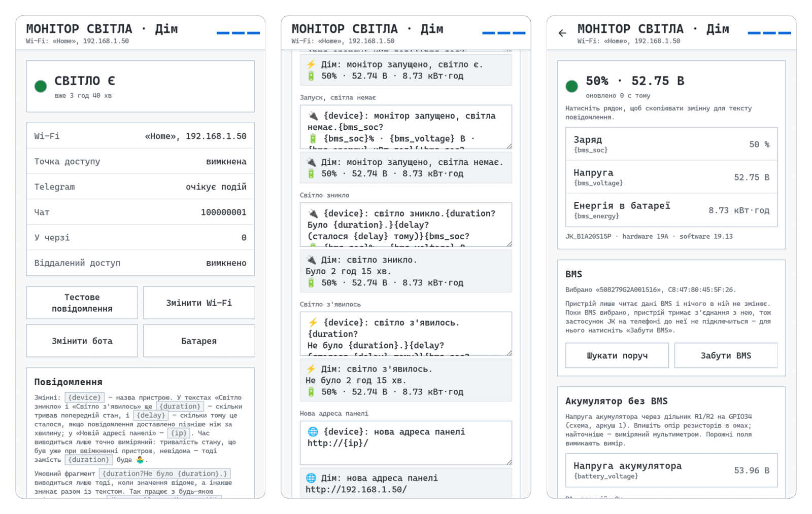
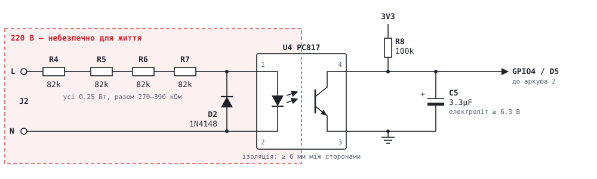

# Монітор світла

Невеликий пристрій, який стежить, чи є вдома 220 В, і повідомляє, коли світло зникає або з'являється.
Живиться від того самого акумулятора, що тримає роутер під час відключень, тож повідомлення
«світло зникло» встигає піти. Може також міряти напругу акумулятора або читати JK BMS.

> 🔌 Дім: світло зникло.
> Було 3 год 40 хв.
> 🔋 98% · 54.10 В · 14.20 кВт·год
>
> ⚡ Дім: світло з'явилось.
> Не було 2 год 15 хв.
> 🔋 51% · 52.73 В · 8.83 кВт·год

<picture>
  <source media="(prefers-color-scheme: dark)" srcset="docs/screens-dark.png">
  
</picture>

<details>
<summary><b>In English</b></summary>

A small ESP32 device that watches whether the house has 220 V mains and posts to Telegram when power goes
out or comes back. It runs from the same battery that keeps the router up during outages, so the "power is
out" message gets through. It can also measure the battery voltage through a divider or read a JK BMS over
Bluetooth. Setup is a web page on the device itself: no cloud, no Home Assistant. The firmware is Rust on
ESP-IDF; ready images for an ESP32 with 4 MB flash are in the
[releases](https://github.com/pavver/power-monitor/releases). There is also an ESPHome variant for a
Wemos D1 mini and Home Assistant. The docs are in Ukrainian; issues in English are welcome.

</details>

## Можливості

- **Повідомлення в Telegram:** у чат, групу або гілку форуму. Тексти для кожної події редагуються, зі змінними:
  тривалість попереднього стану, напруга акумулятора, заряд із BMS.
- **Без хмари й без Home Assistant:** налаштування через сторінку пристрою. Перший запуск відкриває
  точку доступу з покроковим майстром: Wi-Fi, потім бот.
- **Напруга акумулятора** через дільник на АЦП (свинцевий, LiFePO4 — будь-який до 80 В) або **JK BMS** по
  Bluetooth: заряд, напруга, запас енергії в кВт·год.
- **Нічого не губиться:** якщо разом зі світлом пропав інтернет, події стоять у черзі й ідуть, щойно
  зв'язок повернеться, з позначкою, коли це сталося.
- **Оновлення по Wi-Fi** з відкатом: якщо нова прошивка не стартує, повертається попередня.
- **Пароль на панель**, скидання налаштувань п'ятьма короткими вмиканнями живлення.
- **Віддалена підтримка** (необов'язково): можна відкрити панель пристрою, що стоїть в іншому місці,
  через власний сервер.

Є і варіант для **Home Assistant** на Wemos D1 mini з ESPHome: він лише передає «світло є/немає» і
напругу акумулятора, а повідомлення надсилає Home Assistant.

## З чого почати

1. **Зберіть пристрій** за [інструкцією](hardware/README.md). Там три варіанти: модуль ESP32-WROOM-32 на
   власній платі, готова плата ESP32 DevKit або Wemos D1 mini для Home Assistant.
2. **Прошийте:** ESP32 — готовим образом із [релізів](#готова-прошивка) або
   [зібравши самостійно](#збірка-і-прошивка), D1 mini — за [інструкцією ESPHome](esphome/README.md).
3. **Налаштуйте** через телефон: [Налаштування](#налаштування).

Серце пристрою — оптопара, що бачить 220 В і віддає ESP32 лише «є/немає»
(аркуш 3, решта схеми — в [інструкції](hardware/README.md)):

<picture>
  <source media="(prefers-color-scheme: dark)" srcset="hardware/sheet-3-mains-dark.svg">
  
</picture>

## Структура

| Тека | Що там |
| --- | --- |
| [`hardware/`](hardware) | Схеми (SVG), інструкція зі збирання, перелік деталей. |
| [`firmware/`](firmware) | Прошивка ESP32 на Rust (ESP-IDF, std): GPIO, АЦП, Wi-Fi, NVS, HTTP-сервер, Telegram, Bluetooth. `ui/index.html` — сторінка пристрою. |
| [`power-core/`](power-core) | Уся логіка без заліза: детектор, шаблони, налаштування, розбір кадрів BMS, API. Тести запускаються на ПК: `cargo test`. |
| [`esphome/`](esphome) | Конфігурація для Wemos D1 mini і Home Assistant. |
| [`server/`](server) | Сервер віддаленої підтримки (необов'язковий). |

## Готова прошивка

Кожен [реліз](https://github.com/pavver/power-monitor/releases) містить два образи для ESP32 з 4 МБ флешу,
зібрані GitHub Actions з тегу. Віддалена підтримка в них вимкнена, дільник напруги — з аркуша 1 схеми
(усе змінюється на панелі).

| Файл | Коли |
| --- | --- |
| `power-monitor-full.bin` | Перша прошивка нової плати: завантажувач, таблиця розділів і прошивка одним файлом. Пишеться з адреси `0x0` і стирає збережені налаштування. |
| `power-monitor.bin` | Оновлення пристрою, що вже працює: панель → «Прошивка» ([OTA](#оновлення-через-wi-fi-ota)). |

Записати повний образ можна будь-яким інструментом:

- **У браузері** (Chrome або Edge): [ESP Tool](https://espressif.github.io/esptool-js/) → «Connect» →
  адреса `0x0`, файл `power-monitor-full.bin` → «Program».
- **esptool:** `esptool.py --chip esp32 write_flash 0x0 power-monitor-full.bin`
- **espflash:** `espflash write-bin 0x0 power-monitor-full.bin`

Далі — [налаштування](#налаштування) з телефона.

## Збірка і прошивка

Потрібні Linux або macOS (на Windows — WSL), [Rust](https://rustup.rs) і тулчейн для ESP32:

```sh
cargo install espup ldproxy espflash --locked
espup install          # створить ~/export-esp.sh
```

Підключіть ESP32 через USB і запустіть:

```sh
./flash.sh                  # тести → збірка → прошивка → монітор порту
./flash.sh -p /dev/ttyUSB0  # явно вказати порт
./flash.sh --reset          # ще й стерти збережені налаштування
./flash.sh --no-monitor
./flash.sh --image          # лише зібрати образи: power-monitor.bin (OTA) і power-monitor-full.bin
```

Перша збірка завантажує ESP-IDF і триває 10–20 хвилин; наступні — до хвилини.

### Оновлення через Wi-Fi (OTA)

Перший раз прошивайте через USB (`./flash.sh`): так записуються таблиця розділів і завантажувач із
підтримкою відкату. Далі:

1. `./flash.sh --image` — у корені проєкту з'явиться `power-monitor.bin`.
2. Відкрийте панель пристрою → «Прошивка» → оберіть файл → «Оновити».
3. Пристрій перевіряє файл (чи це прошивка ESP32 і чи вміщується в слот), пише його у вільний слот
   (`ota_0`/`ota_1`), перевіряє контрольну суму й перезапускається.

Нова прошивка підтверджує себе, щойно запуститься вебсервер. Якщо вона впаде раніше, після
перезапуску завантажувач поверне попередню.

### Таблиця розділів (4 МБ)

| Розділ | Розмір | Призначення |
| --- | --- | --- |
| `nvs` | 208 КБ | налаштування: Wi-Fi, бот, тексти |
| `otadata`, `phy_init` | 8 + 4 КБ | службові |
| `ota_0`, `ota_1` | по 1920 КБ | два слоти прошивки для OTA |

Таблицю (`firmware/partitions.csv`) записує `espflash` під час прошивки. `flash.sh` стирає `otadata`,
щоб завантажувач запустив щойно записаний `ota_0`.

### Для розробки

- Тести логіки: `cd power-core && cargo test`.
- Схеми перемальовує `python3 hardware/build.py`.
- Шрифт сторінки — Cascadia Code, урізаний до латиниці, кирилиці, цифр і розділових знаків
  (≈26 КБ у прошивці). За ліцензією OFL змінену версію перейменовано на «Operator Mono». Після зміни
  тексту сторінки: `python3 firmware/ui/make-font.py` (скрипт зупиниться, якщо на сторінці є символ
  поза шрифтом).
- Сторінку налаштування можна перевірити в headless Chromium (Playwright) на макеті пристрою:
  `PLAYWRIGHT_CORE=/шлях/до/playwright-core node firmware/ui/ui-check.js firmware/ui/index.html /tmp/shots`.

## Налаштування

1. Увімкніть пристрій. Поки налаштування не завершено (немає Wi-Fi або бота), він створює точку доступу
   «PowerMonitor-Setup». Підключіться до неї телефоном — сторінка відкриється сама (або відкрийте
   http://192.168.71.1/).
2. **Wi-Fi.** Список мереж оновлюється сам. Оберіть мережу, введіть пароль. Кнопка «Підключити» чекає,
   поки пристрій справді підключиться або повідомить причину невдачі. Мережа зберігається лише після
   вдалого підключення.
3. **Повернення в домашню мережу.** Сторінка показує адресу, яку роутер видав пристрою (її можна
   скопіювати). Кнопка «Перейти в домашню мережу» вимикає точку доступу, і телефон сам повертається до
   домашнього Wi-Fi. Далі сторінку відкривають за цією адресою. Якщо вона не відкривається, перезапуск
   пристрою знову піднімає точку доступу.
4. **Telegram-бот** — уже з домашньої мережі, бо телефону потрібен інтернет. Створіть бота в
   [@BotFather](https://t.me/BotFather), вставте токен (пристрій перевіряє його), напишіть боту і виберіть
   чат зі списку. Пристрій надішле тестове повідомлення. У групі бот бачить лише команди, тому там треба
   надіслати `/start`. У групі з гілками кожна гілка, з якої написали, — окремий рядок списку.
5. **Панель.** Стан світла, Wi-Fi, Telegram, черга; тестове повідомлення; зміна Wi-Fi чи бота; тексти
   повідомлень.

### Тексти повідомлень

Кожне повідомлення має свій текст: запуск зі світлом, запуск без світла, світло зникло, світло з'явилося,
нова адреса панелі й тестове. Порожній текст вимикає повідомлення; тестове вимкнути не можна, ним
перевіряється бот. Змінні:

| Змінна | Що підставляється | Де є |
| --- | --- | --- |
| `{device}` | назва пристрою | усюди |
| `{duration}` | скільки тривав попередній стан, наприклад «2 год 15 хв» | світло зникло / з'явилося |
| `{delay}` | скільки тому сталася подія, якщо повідомлення доставлено пізніше ніж за хвилину | світло зникло / з'явилося |
| `{ip}` | нова адреса пристрою в домашній мережі | нова адреса панелі |
| `{battery_voltage}` | напруга акумулятора через дільник, В | усюди |
| `{bms_soc}` | заряд за BMS, % | усюди |
| `{bms_voltage}` | напруга за BMS, В | усюди |
| `{bms_energy}` | енергія, що лишилася в батареї, кВт·год | усюди |

Якщо значення недоступне (дільник не налаштовано або на вході шум, BMS не відповіла, тривалість невідома,
повідомлення не запізнилось), замість нього буде 🤷‍♂️. Стандартні тексти зміни світла закінчуються рядком
`{delay?\n(сталося {delay} тому)}`.

Щоб замість 🤷‍♂️ прибрати весь шматок тексту, візьміть його в умовний фрагмент `{змінна?текст}`: текст
виводиться лише тоді, коли значення відоме. Наприклад, `⚡ {device}: світло з'явилось.{duration? Не було {duration}.}`
одразу після ввімкнення пристрою, коли тривалість ще невідома, надішле лише «⚡ Дім: світло з'явилось.». Усередині
фрагмента можна переносити рядок і вкладати інші фрагменти. Перенос рядка можна писати й як `\n`:
`{duration?\nНе було {duration}.}`. Попередній перегляд під полем заповнює сам пристрій за тими самими правилами.

Знак оклику перевертає умову: `{!змінна?текст}` виводиться лише тоді, коли значення **немає**. Так можна
поставити одне значення замість іншого. Стандартні тексти закінчуються рядком батареї, що бере BMS, а якщо її
немає або вона не відповідала довше хвилини — напругу з дільника:

```text
{bms_soc?\n🔋 {bms_soc}% · {bms_voltage} В · {bms_energy} кВт·год}{!bms_soc?{battery_voltage?\n🔋 {battery_voltage} В}}
```

Нові стандартні тексти діють там, де тексти ще ніхто не зберігав; збережені на панелі лишаються як є.
Тексти, збережені у версії 0.1.0, яка сама дописувала примітку про запізнення, після оновлення отримують
у кінці `{delay?\n(сталося {delay} тому)}`, тож повідомлення не змінюються.

### Акумулятор: дільник напруги або BMS

На панелі кнопка «Батарея» відкриває екран із двома картками:

- **Акумулятор без BMS.** Впишіть опір R1 і R2 з аркуша 1 схеми в омах (найточніше — виміряні
  мультиметром). Пристрій покаже напругу; порівняйте її з мультиметром. Порожні поля вимикають вимір.
  Якщо дільник не розпаяно, вхід «висить» і показує шум замість напруги: пристрій це помічає, на екрані
  буде «шум», а в повідомленнях напруга вважатиметься невідомою.
  Поки на панелі нічого не задано, пристрій вважає, що стоять R1 330k і R2 10k з аркуша 1. Інші
  резистори можна вшити при збірці. На панелі їх можна змінити або вимкнути, а скидання до заводських
  повертає вшиті:

  ```sh
  DIVIDER_TOP_OHM=240000 DIVIDER_BOTTOM_OHM=10000 ./flash.sh
  ```
- **BMS.** «Шукати поруч» → «Обрати». Пристрій лише читає JK BMS по Bluetooth LE (протокол JK02: 24S до
  заліза 10.x, 32S з 11.x) і нічого в ній не змінює. З'єднання тримається весь час, поки BMS вибрано
  (застосунок JK на телефоні тим часом не підключиться: BMS приймає одне з'єднання). Повідомлення не
  чекає на BMS: бере останнє значення, якщо воно не старше хвилини, інакше 🤷‍♂️. Без збереженої BMS
  пам'ять Bluetooth віддається решті прошивки.

Розбір кадрів BMS перевірено на записах справжніх BMS із тестів
[esphome-jk-bms](https://github.com/syssi/esphome-jk-bms) (Apache-2.0).

### Пароль панелі

Спочатку панель відкрита. У розділі «Доступ до панелі» можна задати пароль (4–64 символи). Після цього
кожен браузер має увійти; зберігається лише хеш пароля з сіллю. Зміна або вимкнення пароля завершує всі
інші сесії.

### Нова IP-адреса

Пристрій пам'ятає свою останню адресу в домашній мережі. Якщо після підключення адреса інша, в Telegram
приходить посилання на панель: «🌐 Дім: нова адреса панелі http://192.168.1.50/». Текст змінюється на панелі,
як і решта повідомлень.

### Скидання до заводських налаштувань

Стирає Wi-Fi, бота, тексти, пароль і запам'ятовану адресу:

- **без доступу до панелі** (забули пароль): 5 разів поспіль увімкніть живлення і через 2–3 секунди
  вимкніть — кожне вмикання коротше за 10 секунд;
- на панелі — кнопка «Скинути все»;
- через USB — `./flash.sh --reset`.

Якщо збережена мережа недоступна під час старту, точка налаштування теж вмикається, а пристрій далі
пробує підключитися.

## Віддалена підтримка (необов'язково)

Якщо ви ставите пристрої друзям чи батькам, можна відкривати їхню панель через власний сервер
([`server/`](server/README.md)). Пристрій сам звертається до сервера, тож у мережі клієнта нічого
відкривати не треба:

- **чек-ін** раз на годину (перший — за хвилину після старту): `POST /device/checkin`; якщо на сервері
  для пристрою ввімкнено «Чекаю пристрій», чек-іни йдуть кожні 2 хв;
- **сесія** відкривається, коли власник натиснув «Відкрити панель» на сервері (на найближчому чек-іні)
  або коли клієнт натиснув «З'єднатись зараз» у своїй панелі. Пристрій тримає одне TLS-з'єднання й
  чекає запитів (`GET /device/next`, long-poll 25 с), виконує їх своїм вебсервером і повертає відповідь.
  Працює все, що й удома, разом з OTA. Пароль панелі клієнта діє і тут;
- сесія закривається через 15 хв без запитів, кнопкою «Завершити сесію» з будь-якого боку або
  вимкненням перемикача.

За замовчуванням підтримка вимкнена: пристрій нікуди не звертається, поки в картці «Віддалена
підтримка» не вписати адресу сервера (лише `https://`) і не ввімкнути перемикач. Щоб нові пристрої
одразу знали ваш сервер, вшийте його при збірці:

```sh
REMOTE_SERVER=https://svitlo.example.com ./flash.sh
```

Такі пристрої стартують з увімкненою підтримкою, і клієнт може її вимкнути. Як підняти сервер —
у [server/README.md](server/README.md).

## Глосарій

- **Вікно** — 100 послідовних вимірів піна з кроком 1 мс.
- **Низький вимір** — вимір, під час якого оптопара притягнула пін до землі.
- **Стан живлення** (`PowerState`) — `Present` (світло є) або `Absent` (немає).
- **Підтвердження** — стан приймається, коли 10 вікон підряд (1 с) кажуть одне й те саме.
- **Подія** (`PowerEvent`) — підтверджений стан, момент його початку і скільки тривав попередній.
- **Черга** (`Outbox`) — події, які ще не доставлено в Telegram; доставляються по черзі.
- **Режим налаштування** — точка доступу «PowerMonitor-Setup» + DNS, що веде все на сторінку.
- **Етап** (`Stage`) — Wi-Fi → бот → панель; визначається тим, що вже збережено.
- **Слот** — розділ `ota_0` або `ota_1`; один працює, у другий пишеться оновлення.
- **Швидке вмикання** — старт, після якого живлення зникло раніше ніж за 10 с; п'ять поспіль скидають налаштування.
- **Сесія панелі** — вхід у панель конкретного браузера (cookie), коли задано пароль.
- **Шаблон** — текст повідомлення для однієї події зі змінними.
- **Дільник** (`Divider`) — R1 і R2, що зменшують напругу акумулятора до діапазону АЦП.
- **Показники** (`Readings`) — що виміряно для одного повідомлення: напруга через дільник і значення BMS.
- **BMS** — плата керування батареєю JK; поки вибрана, з'єднання з нею тримається постійно.
- **Кадр** (`jk::Frame`) — 300 байт від BMS, що приходять шматками по BLE і закриваються контрольною сумою.
- **Чек-ін** — короткий запит пристрою до сервера підтримки: «чи потрібен я?».
- **Сесія підтримки** — час, коли пристрій чекає на сервері запитів до своєї панелі й виконує їх.

## Ліцензія

[MIT](LICENSE). Шрифт сторінки — [SIL Open Font License](firmware/ui/OFL.txt). Записи кадрів BMS у
`power-core/src/jk_frames.rs` взято з [esphome-jk-bms](https://github.com/syssi/esphome-jk-bms)
(Apache-2.0). У `firmware/vendor/esp32-nimble/` лежить копія бібліотеки
[esp32-nimble](https://github.com/taks/esp32-nimble) 0.13.0 (Apache-2.0) з виправленням підключення;
що змінено й навіщо — у [PATCHED.md](firmware/vendor/esp32-nimble/PATCHED.md), запит на включення в
бібліотеку — [taks/esp32-nimble#210](https://github.com/taks/esp32-nimble/pull/210).
