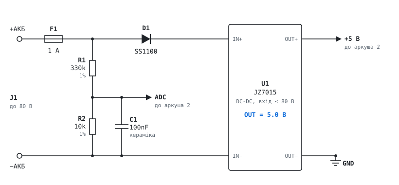
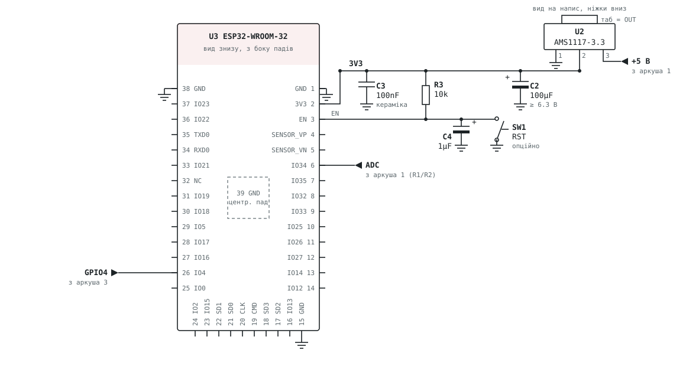
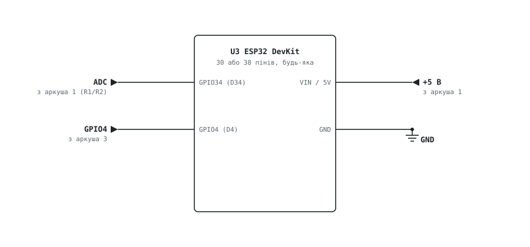
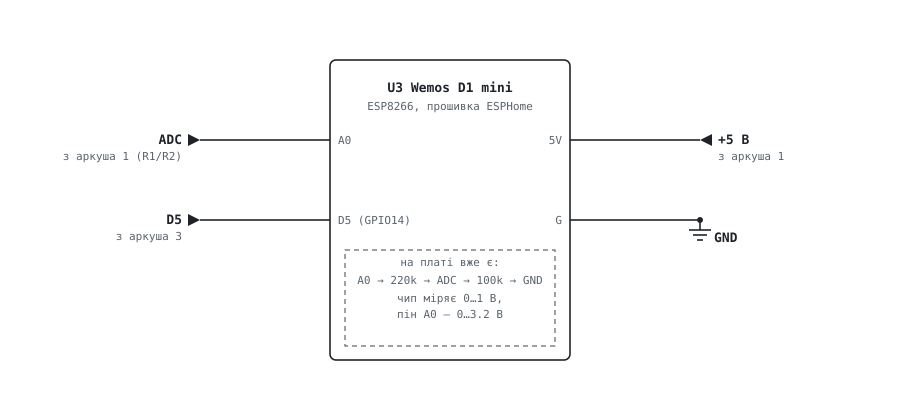
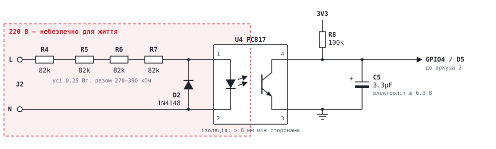

# Збирання монітора світла

Пристрій живиться від акумулятора (того самого, що тримає роутер чи інвертор під час відключень),
стежить за наявністю 220 В через оптопару і міряє напругу акумулятора.

Схема складається з трьох аркушів:

1. **Живлення і дільник напруги.** Однаковий для всіх варіантів.
2. **Контролер.** Три варіанти на вибір, див. нижче.
3. **Датчик 220 В.** Однаковий для всіх варіантів.

Аркуші малює [`build.py`](build.py): `python3 hardware/build.py` перезаписує SVG-файли поруч.

## Який варіант обрати

| Варіант | Плата | Прошивка | Коли підходить |
|---|---|---|---|
| **А** | модуль ESP32-WROOM-32 на власній платі | Rust ([`firmware/`](../firmware)) | найкомпактніше; потрібна плата-програматор із сокетом для першої прошивки |
| **Б** | будь-яка ESP32 DevKit (30 або 38 пінів) | Rust ([`firmware/`](../firmware)) | найпростіше зібрати: стабілізатор 3.3 В, USB і кнопки вже на платі |
| **В** | Wemos D1 mini (ESP8266) | ESPHome ([`esphome/`](../esphome)) | вдома вже є Home Assistant |

Варіанти **А** і **Б** працюють самостійно: власна вебсторінка для налаштування, повідомлення в Telegram,
читання JK BMS по Bluetooth. Home Assistant для них не потрібен.

Варіант **В** нічого не надсилає сам: він передає в Home Assistant два значення, «світло є/немає» і напругу
акумулятора. Повідомлення й автоматизації налаштовуються вже в Home Assistant. ESP8266 не має Bluetooth,
тому JK BMS цей варіант не читає.

## Аркуш 1. Живлення і дільник напруги

<picture>
  <source media="(prefers-color-scheme: dark)" srcset="sheet-1-power-dark.svg">
  
</picture>

Акумулятор живить пристрій через запобіжник **F1**. Одразу за ним стоїть дільник **R1/R2**: він зменшує
напругу акумулятора до рівня, який безпечно міряє АЦП контролера. **C1** згладжує завади на вході АЦП.
Далі діод **D1** захищає від переплутаної полярності, а DC-DC **U1** робить 5 В для контролера.

- **Дільник підключений до діода, а не після нього.** Падіння напруги на діоді залежить від струму і
  температури, і через нього вимір був би неточним. Якщо переплутати полярність, через R1 потече лише
  ~0.25 мА: стільки вхід контролера витримує.
- **R1 і R2 — з допуском 1%.** Прошивка рахує напругу з їхніх номіналів, які ви вкажете в налаштуваннях.
  Найточніше — виміряти кожен резистор мультиметром до пайки і вписати виміряне значення.
- **C1 паяйте ближче до контролера**, а не біля акумулятора. На схемі він стоїть поруч із R2 лише для
  наочності.
- **U1** — будь-який понижувальний DC-DC з виходом 5 В, розрахований на напругу вашого акумулятора
  (JZ7015 працює до 80 В). Конденсатори на вході й виході вже є на самому модулі, окремі не потрібні.
  **Спершу** подайте живлення на U1 без навантаження і підкрутіть підстроювальний резистор до **5.0 В**.
  Лише потім підключайте контролер.
- **D1** — діод Шотткі на 100 В і більше (SS1100, SS210) або 1N4007. Смужка на корпусі (катод) — до U1.
- Мінус акумулятора — це земля (GND) усієї схеми. З мережею 220 В він ніяк не з'єднаний.

### Підбір R1 під свій акумулятор

АЦП ESP32 точно міряє до ~2.45 В. R1 обирайте так, щоб найвища напруга акумулятора (повністю
заряджений, на зарядці) давала на вході АЦП не більше цього. R2 завжди 10k.

| Акумулятор | Найвища напруга | R1 | Межа виміру (ESP32) |
|---|---|---|---|
| 12 В (свинцевий, LiFePO4 4S) | до 15 В | 56k | 16 В |
| 24 В | до 30 В | 120k | 31 В |
| 48 В (свинцевий, LiFePO4 16S) | до 60 В | 240k | 61 В |
| до 80 В (межа JZ7015) | до 80 В | 330k | 83 В |

Межа виміру = 2.45 В × (R1 + R2) / R2. Що ближче межа до справжньої напруги акумулятора, то точніший вимір.
Для варіанта **В** підходять ті самі резистори (див. аркуш 2в).

## Аркуш 2. Контролер

Оберіть один із трьох.

### Варіант А: модуль ESP32-WROOM-32

<picture>
  <source media="(prefers-color-scheme: dark)" srcset="sheet-2a-wroom-dark.svg">
  
</picture>

Модуль намальований **знизу, з боку падів**. Якщо паяєте модуль екраном догори, ліва і права сторони
поміняються місцями. Цифри — номери падів.

- **U2 AMS1117-3.3** робить 3.3 В із 5 В. Ніжки корпусу SOT-223, якщо дивитися на напис ніжками вниз:
  зліва направо **1 GND, 2 OUT, 3 IN**. Широкий таб зверху з'єднаний з OUT усередині корпусу, тож вихід можна
  брати з ніжки 2 або з таба. Таб ні з чим іншим не з'єднуйте.
- **C2** (100µF) бажано електролітичний: оригінальна AMS1117 з самою керамікою на виході може генерувати.
  Якщо електролітів немає, поставте 22µF кераміку і перевірте, що на виході рівно 3.3 В.
- **C3** (100nF, маркування 104) — обов'язково керамічний і впритул до пада 2. Короткі піки струму Wi-Fi
  гасить саме він: електроліт на таких частотах не працює.
- **R3 і C4** затримують старт після подачі живлення. Без них модуль іноді не стартує на повільному
  фронті живлення. **SW1** (перезапуск) можна не ставити.
- **Земля** — пади 1, 15 і 38, кожен паяється до GND. Пад 39 — великий пад під модулем: якщо паяєте
  звичайним паяльником, його можна не паяти, трьох бокових досить.
- **Інші пади лишайте вільними.** Пади 17–22 (SD0–SD3, CMD, CLK) — це внутрішній флеш модуля, їх не можна
  ні з чим з'єднувати чи замикати припоєм. IO12 (пад 14) при «1» на старті перемикає флеш на 1.8 В, і
  модуль не завантажиться. IO0, IO2, IO5, IO15 і UART (TXD0, RXD0) теж впливають на старт.
- **Прошивка до пайки.** Модуль прошивається один раз у платі-програматорі з сокетом (`./flash.sh`, див.
  [головний README](../README.md)), а далі оновлюється по Wi-Fi. Wi-Fi і бота зручно налаштувати, поки
  модуль ще в сокеті.

### Варіант Б: ESP32 DevKit

<picture>
  <source media="(prefers-color-scheme: dark)" srcset="sheet-2b-devkit-dark.svg">
  
</picture>

Стабілізатор 3.3 В, конденсатори і кнопки вже є на платі. Підключити треба чотири дроти:

| Звідки | Пін DevKit |
|---|---|
| +5 В з аркуша 1 | **VIN** (на деяких платах — **5V**) |
| GND | **GND** |
| вихід дільника (ADC) з аркуша 1 | **GPIO34** (підписаний D34 або 34) |
| вихід датчика з аркуша 3 | **GPIO4** (D4 або 4) |

Розташування пінів на різних DevKit відрізняється, тож шукайте пін за підписом на платі. На більшості
DevKit між USB і VIN стоїть діод, але не на всіх, тож на час прошивки через USB від'єднайте +5 В від DC-DC.

### Варіант В: Wemos D1 mini з ESPHome

<picture>
  <source media="(prefers-color-scheme: dark)" srcset="sheet-2c-d1-mini-dark.svg">
  
</picture>

| Звідки | Пін D1 mini |
|---|---|
| +5 В з аркуша 1 | **5V** |
| GND | **G** |
| вихід дільника (ADC) з аркуша 1 | **A0** |
| вихід датчика з аркуша 3 | **D5** (GPIO14) |

На самій D1 mini перед входом A0 вже стоїть дільник 220k/100k. Разом із R1/R2 з аркуша 1 це працює так
само, лише з меншою роздільністю: з R1 = 330k один крок АЦП — це ~0.11 В. Номінали R1 і R2 вписуються у
файл [`esphome/power-monitor.yaml`](../esphome/power-monitor.yaml), там же — як його прошити.

## Аркуш 3. Датчик 220 В

<picture>
  <source media="(prefers-color-scheme: dark)" srcset="sheet-3-mains-dark.svg">
  
</picture>

> ⚠️ **Ліворуч від червоної пунктирної лінії — напруга мережі, небезпечна для життя.** Вона є на всіх
> деталях цієї частини, навіть на маленьких. Не торкайтеся плати, поки підключено 220 В. Плата має
> бути в закритому корпусі.

Як це працює: коли є 220 В, світлодіод оптопари **U4** блимає 50 разів на секунду і щоразу розряджає
**C5**. Між спалахами (~12 мс) резистор **R8** разом із внутрішньою підтяжкою контролера встигає
зарядити C5 лише до ~0.4 В, тож поки світло є, на вході постійно «0». Світло зникло — C5 заряджається,
і за ~0.15 с вхід переходить в «1» один раз, без брязкоту.

- **R4–R7** обмежують струм світлодіода до ~1 мА. Підійдуть будь-які чотири резистори 68k–100k, аби
  разом 270–390 кОм. Не ставте менше трьох: на одному резисторі 0.25 Вт має бути не більше ~150 В.
  Усі разом гріються на ~0.16 Вт.
- **D2 обов'язковий:** світлодіод PC817 витримує лише 6 В у зворотному напрямку. Смужка 1N4148 (катод) —
  до піна 1 оптопари.
- **C5 — електроліт 3.3µF:** «+» до виходу (R8), «−» (смужка на корпусі) на GND. Підійде й більший,
  4.7–10µF. Менший (2.2µF) на морозі може не втримати «0» між спалахами.
- Пін 1 PC817 — біля точки або виїмки на корпусі.
- Між частиною 220 В і рештою плати тримайте зазор не менше 6 мм.

## Перелік деталей

### Спільні (аркуші 1 і 3)

| Позиція | Номінал | Призначення | Заміна |
|---|---|---|---|
| J1 | клеми 2-пін | вхід акумулятора | |
| F1 | 1 A | запобіжник у плюс акумулятора | 0.5–2 A |
| R1 | 330k 1% | дільник, верхній | див. «Підбір R1» |
| R2 | 10k 1% | дільник, нижній | |
| C1 | 100nF кераміка (104) | фільтр входу АЦП | |
| D1 | SS1100 | захист від переплутаної полярності | SS210, 1N4007 (≥ 100 В) |
| U1 | JZ7015 | DC-DC, виставити 5.0 В | інший DC-DC 5 В на вашу напругу |
| J2 | клеми 2-пін | вхід 220 В | |
| R4–R7 | 4 × 82k 0.25 Вт | струм світлодіода ~1 мА | 68k–100k кожен |
| D2 | 1N4148 | захист світлодіода від зворотної напруги | 1N4007 |
| U4 | PC817 | оптопара | EL817, LTV817 |
| R8 | 100k | підтяжка виходу | не менше 47k |
| C5 | 3.3µF ≥ 6.3 В, електроліт | фільтр 50 Гц | 4.7–10µF |

### Варіант А

| Позиція | Номінал | Призначення | Заміна |
|---|---|---|---|
| U2 | AMS1117-3.3 | стабілізатор 3.3 В | ME6211, AP2112, RT9013 — у них інша розпіновка |
| C2 | 100µF ≥ 6.3 В, електроліт | вихід стабілізатора | 22µF кераміка |
| U3 | ESP32-WROOM-32 | модуль | WROOM-32E, WROOM-32D |
| C3 | 100nF кераміка (104) | біля пада 3V3 | тільки кераміка |
| R3, C4 | 10k, 1µF електроліт | затримка старту | |
| SW1 | кнопка | перезапуск, опційно | |

### Варіант Б

| Позиція | Номінал | Призначення |
|---|---|---|
| U3 | ESP32 DevKit | будь-яка плата з ESP32-WROOM-32 і пінами GPIO4, GPIO34 |

### Варіант В

| Позиція | Номінал | Призначення |
|---|---|---|
| U3 | Wemos D1 mini | ESP8266; підійдуть і клони |

## Порядок складання і перевірки

1. **Живлення без контролера.** J1, F1, D1, U1. Подати живлення від акумулятора і виставити на виході U1
   рівно 5.0 В.
2. **Дільник.** R1, R2, C1. Виміряти напругу між виходом дільника і GND: вона має дорівнювати напрузі
   акумулятора × R2 / (R1 + R2). Наприклад, 52 В × 10k / 340k = 1.53 В.
3. **Контролер.**
   - **А:** спершу прошити модуль у сокеті (`./flash.sh`) і налаштувати Wi-Fi та бота. Потім U2, C2,
     перевірити 3.3 В на виході U2, і лише тоді U3, C3, R3, C4, SW1.
   - **Б:** прошити плату через USB (`./flash.sh`), налаштувати Wi-Fi та бота, підключити чотири дроти.
   - **В:** прошити D1 mini через USB з ESPHome (див. [`esphome/`](../esphome)), підключити чотири дроти.
4. **Вказати номінали дільника.** Для **А** і **Б**: на сторінці пристрою, у розділі «Акумулятор без
   BMS», вписати R1 і R2. Порівняти показану напругу з мультиметром. Для **В**: у YAML-файлі.
5. **Вихідна сторона датчика.** R8, C5, U4, поки без 220 В. На вході контролера має бути ~3.3 В,
   на сторінці пристрою — «світла немає».
6. **Сторона 220 В.** R4–R7, D2, J2. Плату — в закритий корпус, і лише потім вмикати мережу. На вході
   контролера має бути менше 0.5 В, на сторінці — «світло є». Вимкнути 220 В — за ~1.5 с пристрій
   покаже, що світла немає, і надішле повідомлення.
